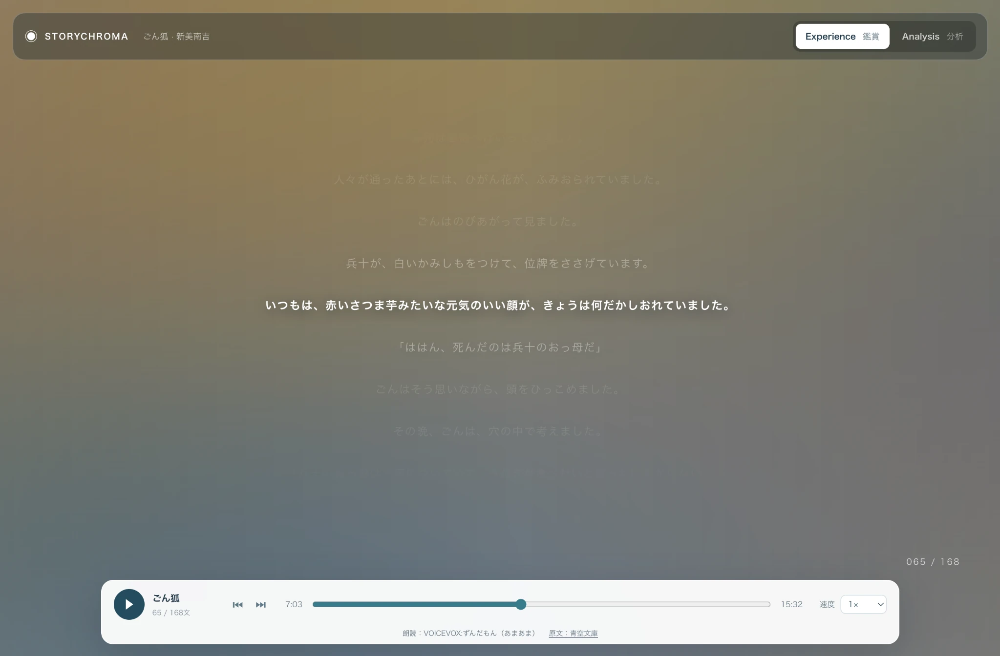
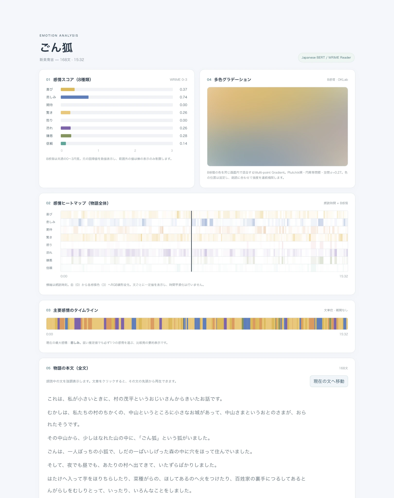

# StoryChroma

**An Interactive Audiobook with Text-Based Emotion Visualization**

StoryChroma is an interactive Japanese audiobook that synchronizes narration, literary text, and dynamic color visualization based on model-estimated emotions.

The application currently features *Gongitsune* (ごん狐), a short story by Nankichi Niimi, with 168 text segments and approximately 15 minutes and 33 seconds of synthesized narration.

Rather than assigning a single emotion to each sentence, StoryChroma visualizes eight emotion dimensions simultaneously, using spatial color blending and continuous transitions synchronized with playback.

**[Live Demo](https://nha6ki.github.io/StoryChroma/)** · **[Project Page](https://nha6ki.github.io/projects/storychroma/)**

## Screenshots and Demo

### Experience

The Experience view combines synchronized narration, highlighted text, and a continuously changing emotion-based color gradient.

<a href="docs/media/storychroma-experience.webp">
  
</a>

### Analysis

The Analysis view provides sentence-level emotion estimates, a full-story heatmap, a dominant-emotion timeline, and an overview of the generated color visualization.

<a href="docs/media/storychroma-analysis.webp">
  
</a>

### Demo Video

A short demonstration of the interactive audiobook and its dynamic visualization.

https://github.com/user-attachments/assets/e83b916e-6668-41e1-b2f3-1a3faa199a1b

## Features

**Experience view**
- Full-screen, emotion-based color visualization
- Text highlighting synchronized with narration
- Interactive sentence navigation
- Audiobook playback and speed controls

**Analysis view**
- Eight-dimensional emotion scores for the current sentence
- Full-story emotion heatmap
- Dominant-emotion timeline
- Spatial color visualization
- Complete story text with sentence-level seeking

Both views share the same playback state, allowing users to switch between them without restarting the narration.

## How It Works

StoryChroma combines precomputed text analysis and synthesized narration with browser-based visualization.

1. **Text preparation:** The literary text is divided into sentence-level segments.
2. **Emotion estimation:** A Japanese BERT model estimates eight emotion intensities for each segment.
3. **Speech synthesis:** VOICEVOX ENGINE generates narration, and sentence timing is derived from the synthesized audio.
4. **Color visualization:** The estimated emotions are mapped to a spatial color field and interpolated along the narration timeline.
5. **Interactive playback:** The web application synchronizes the text, playback position, and color visualization.

Emotion inference and speech synthesis are performed offline. The published web application uses precomputed JSON and MP3 files, so it does not require a backend inference server.

## Emotion Estimation and Visualization

### Emotion model

StoryChroma uses the Japanese BERT model:

[patrickramos/bert-base-japanese-v2-wrime-fine-tune](https://huggingface.co/patrickramos/bert-base-japanese-v2-wrime-fine-tune)

The model was fine-tuned on WRIME, a Japanese dataset containing emotional intensity annotations for eight categories:

- Joy
- Sadness
- Anticipation
- Surprise
- Anger
- Fear
- Disgust
- Trust

StoryChroma uses the model's **Reader-side predictions**, which estimate emotions that readers might attribute to the writer of a text. These predictions do not measure the emotions experienced by readers themselves.

Raw regression outputs are retained in the generated data. For visualization, values are clipped to the 0–3 range without per-emotion percentile normalization.

### Color visualization

Each emotion is associated with a fixed color and a position in a spatial layout.

The visualization combines multiple emotion dimensions using Gaussian spatial weighting and OKLab color mixing. Emotion scores are interpolated between sentence midpoints to produce continuous color transitions during narration.

This approach represents multiple estimated emotions in a single color field rather than selecting only the highest-scoring category.

The color mapping is a visualization design choice, not a validated representation of how people perceive emotions.

For implementation details and mathematical definitions, see the [Technical Design](docs/technical-design.md).

## Included Story

| Item | Details |
|---|---|
| Title | *Gongitsune* (ごん狐) |
| Author | Nankichi Niimi (新美南吉) |
| Text source | Aozora Bunko |
| Text segments | 168 |
| Narration duration | 932.608 seconds (approximately 15:33) |
| Speech synthesis | VOICEVOX ENGINE |
| Voice | VOICEVOX:ずんだもん（あまあま） |
| Audio format | MP3 |

The segment count reflects the text segmentation used in this implementation.

## Technology

**Web application**
- React and TypeScript
- Vite
- HTML Audio
- Canvas 2D

**Offline data preparation**
- Python
- PyTorch
- Hugging Face Transformers
- VOICEVOX ENGINE
- FFmpeg

## Run Locally

The repository includes the generated narration audio and emotion data. Running the existing application does not require downloading the emotion model or regenerating these files.

**Requirements:** Node.js and npm.

From the repository root:

```bash
cd web
npm ci
npm run dev
```

Open the local URL reported by Vite, typically `http://localhost:5173/`.

### Build and Lint

From the repository root:

```bash
cd web
npm ci
npm run build
npm run lint
```

The production build is generated in `web/dist/`.

### Artifact Validation

The repository includes tests for the generated story data and narration audio.

From the repository root:

```bash
python3 -m unittest discover -s tests -p "test_*.py" -v
```

FFmpeg and FFprobe are required for the audio validation tests.

For environment requirements, validation procedures, and data regeneration, see the [Reproduction Guide](docs/reproduction.md).

## Repository Structure

```text
pipeline/        Text preparation, emotion inference,
                 and narration generation
web/src/         React application
web/public/      Generated story JSON and narration audio
tests/           Artifact validation tests
docs/            Technical and reproduction documentation
docs/media/      Screenshots and demonstration video
data/            Local intermediate files (not tracked)
experiments/     Local visualization experiments (not tracked)
```

## Limitations

StoryChroma is a working visualization prototype, not a validated method for assessing literary emotions or improving reading comprehension.

The emotion model was trained on Japanese social media text, and its performance on literary sentences has not been independently validated in this project.

The predictions should not be interpreted as the author's actual emotional state or as the emotions experienced by an audience.

The color assignments and visualization have not been evaluated through a user study. No claims are made about their effects on comprehension, emotional engagement, or interpretation.

## Data, Attribution, and Licensing

### Literary text

- **Work:** *Gongitsune* (ごん狐)
- **Author:** Nankichi Niimi (新美南吉)
- **Source:** [Aozora Bunko](https://www.aozora.gr.jp/cards/000121/card628.html)
- **Source edition:** *Nankichi Niimi Douwashuu* (新美南吉童話集), Iwanami Bunko
- **Text transcription:** Yuji Hayashi (林裕司)
- **Proofreading:** Satoshi Hamano (浜野智)

The literary work is in the public domain in Japan. The electronic text is credited to Aozora Bunko and its contributors.

See the [Aozora Bunko usage guidelines](https://www.aozora.gr.jp/guide/kijyunn.html).

### Narration

- **Software:** [VOICEVOX](https://voicevox.hiroshiba.jp/)
- **Voice:** VOICEVOX:ずんだもん
- **Style:** あまあま
- **Recorded engine version:** 0.26.1

The generated narration is subject to the applicable [VOICEVOX terms](https://voicevox.hiroshiba.jp/term/) and [Zundamon voice usage terms](https://zunko.jp/con_ongen_kiyaku.html).

### Emotion model and dataset

- **Model:** [patrickramos/bert-base-japanese-v2-wrime-fine-tune](https://huggingface.co/patrickramos/bert-base-japanese-v2-wrime-fine-tune)
- **Model publisher:** patrickramos
- **Listed model license:** CC BY-SA 3.0
- **Training dataset:** [WRIME](https://github.com/ids-cv/wrime)

The model and its training dataset have licensing terms distinct from those of this project's source code.

### Source code license

The original source code in this repository is released under the [MIT License](LICENSE).

This license does not supersede the rights or licensing terms associated with the literary text, synthesized voice, pretrained model, or third-party materials.

See [THIRD_PARTY_NOTICES.md](THIRD_PARTY_NOTICES.md) for additional attribution and licensing information.
